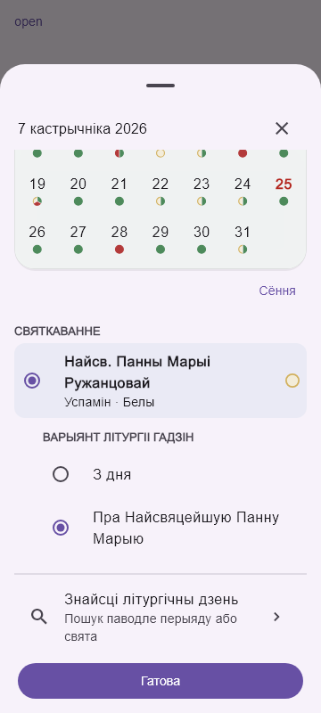
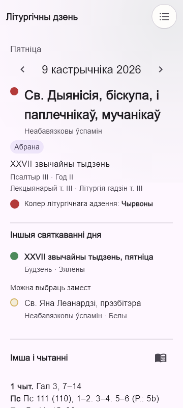
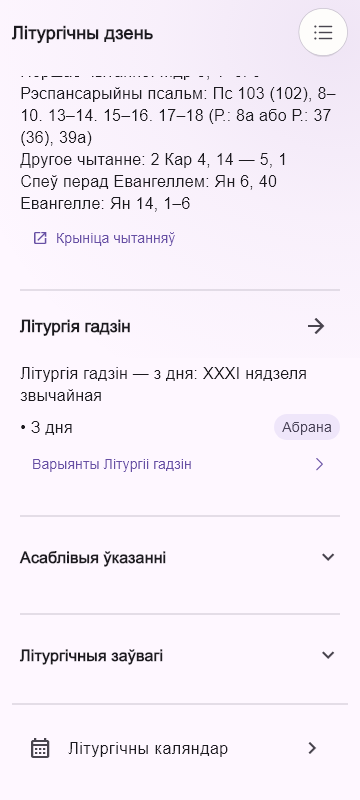

# Литургический интерфейс — снимки

Снимки получены текущими widget-тестами; данные берутся из bundled content.
Календарное окно снято в разных положениях прокрутки, чтобы показать и сетку,
и вложенные варианты. Состояния текста ×2 сняты на ширине 320 px.

| Состояние | Снимок |
|---|---|
| 06.10.2026: сетка и варианты | [Светлая тема](calendar-6-light-1.0.png) |
| 07.10.2026: одно празднование, два Office | [Radio-строка](calendar-7-light-1.0.png) |
| 07.10.2026: выбран Marian Common | [Светлая](calendar-7-common-light-1.0.png), [тёмная ×2](calendar-7-common-dark-2.0.png) |
| 09.10.2026: несколько празднований | [Светлая](calendar-9-light-1.0.png), [тёмная ×2](calendar-9-dark-2.0.png) |
| Быстрый выбор месяца/года | [Обычный текст](month-year-jump.png), [тёмная ×2](month-year-jump-dark-2.0.png) |
| Страница 07.10.2026 | [Шапка](day-7-light.png) |
| Страница 09.10.2026 | [Светлая](day-light-1.0.png), [тёмная ×1.5](day-dark-1.5.png) |
| Выбран св. Бруно | [Шапка](selected-10-6-header.png) |
| Выбран св. Дионисий | [Шапка](selected-10-9-header.png), [Office](selected-10-9-office.png) |
| 13.06.2026: конкурирующие воспоминания | [Выбран альтернативный](selected-6-13-header.png), [указания раскрыты](selected-6-13-directions.png) |
| All Souls 2025 в воскресенье | [Шапка](all-souls-2025-header.png), [наборы чтений](all-souls-2025-readings.png), [воскресный Office](all-souls-2025-office.png) |
| All Souls 2031 в воскресенье | [Шапка](all-souls-2031-header.png), [наборы чтений](all-souls-2031-readings.png) |
| Различия диоцезий | [Шапка](dioceses-header.png), [празднования](dioceses-celebrations.png) |
| Месячный вертикальный список | [Светлая](month-light-1.0.png), [тёмная ×1.5](month-dark-1.5.png) |

