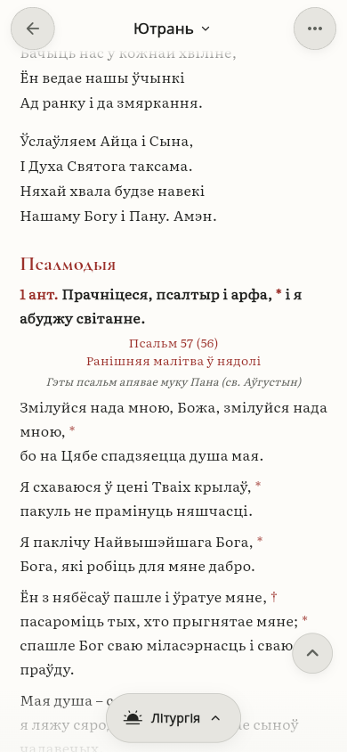
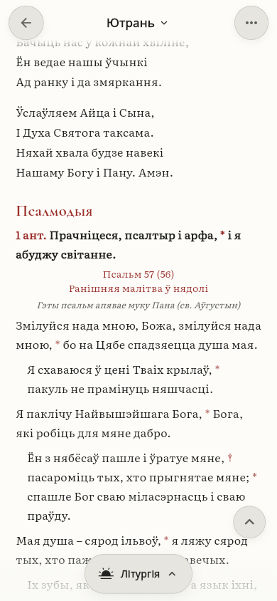
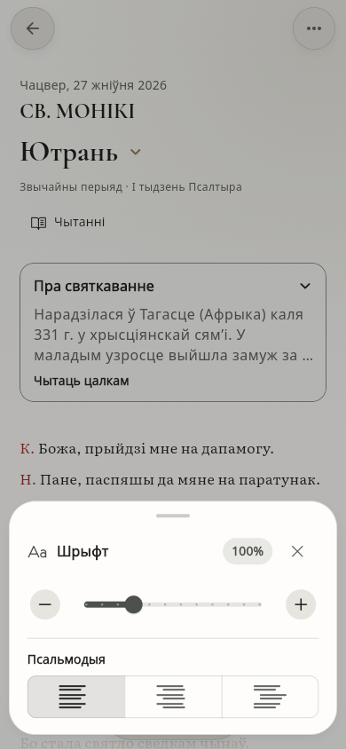
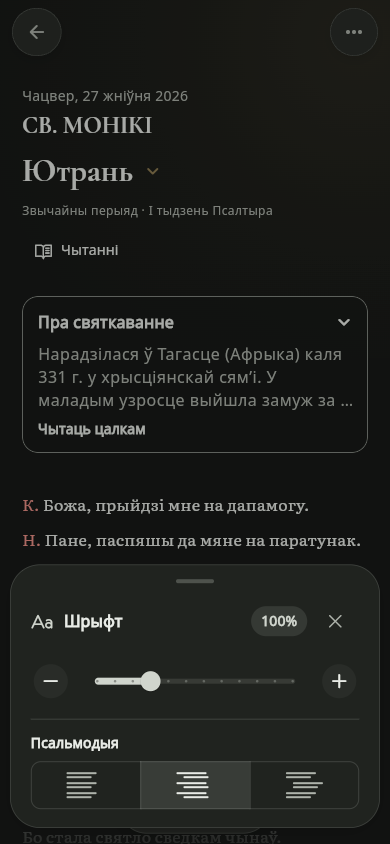
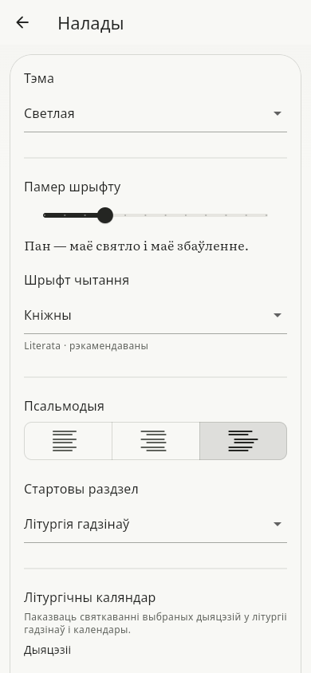
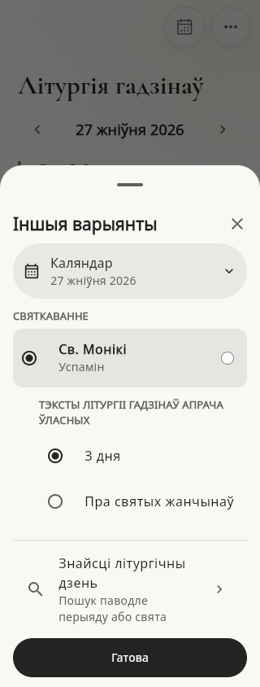
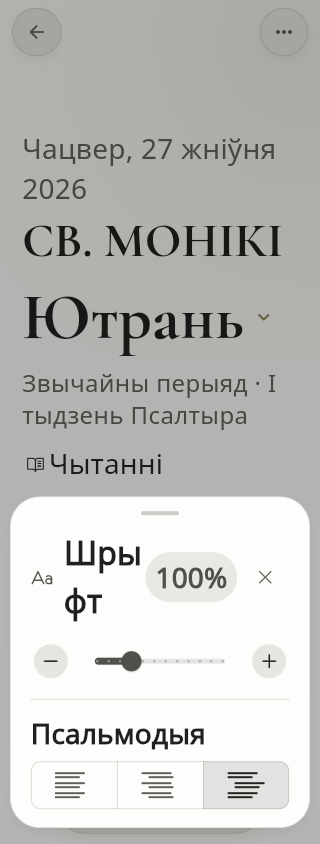
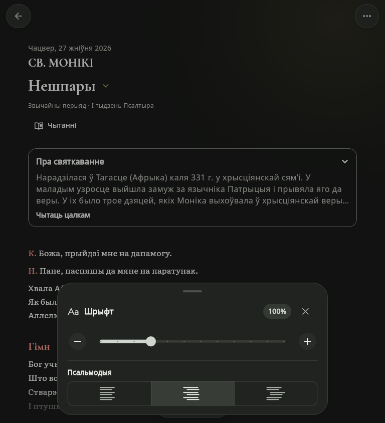
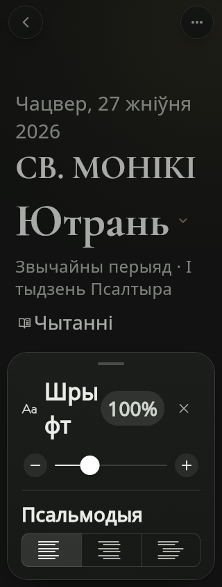

# Литургическая терминология и три режима псалмодии — Flutter

Ветка `codex/flutter-liturgical-psalmody-modes`, исходный `main` — `2420c45cc19ea87b843765d5f658cbc975dc69ed`. Перед изменениями выполнены `git fetch origin main`, просмотр удалённых веток и открытых PR. Связанные Flutter PR [#60](https://github.com/senddownrain/ibreviarybyapp/pull/60) (Proper/Common и I Нешпары) и [#61](https://github.com/senddownrain/ibreviarybyapp/pull/61) (целостность чтений) остаются отдельными; их незавершённая работа не переносилась и не перезаписывалась. Исходная ветка `work` и её неотслеживаемые `ios/Flutter/ephemeral/`, `macos/Flutter/ephemeral/` сохранены.

Сверено с merged Web [PR #190](https://github.com/senddownrain/mybrev/pull/190), head `c84063045ca447d07b877e610bad5688376bf679`. Семантика режимов и таблица миграции согласованы. Во Flutter вход в прежнюю панель Aa/«Шрыфт» остаётся в существующем месте: на текущем main ридер открывает её через прежний пункт с Aa в меню ⋯. `TextScaleControl`, верхняя панель и существующие пути открытия не перенесены и не дублированы. Внутри панели часов остаётся псалмодия; ограничение Web «только общие настройки» сюда не переносилось.

## Реальные надписи и смысл

Поиск выполнен по всему `lib`, включая шесть указанных исходных файлов. Глобальная замена календарных полей, собственных названий или текста документов не применялась.

| Старое | Новое | Реальное место и функция |
| --- | --- | --- |
| Ранг | Літургічная ступень | Литерала «Ранг» в пользовательском Flutter UI текущего main нет. Значения рангов («Успамін» и др.) и внутренние `_rank`/`rank` оставлены без изменений; новая лишняя подпись не добавлялась. |
| `{sets.length} {massSetVariantWord(...)} аднаго святкавання` | Магчымасці цэлебрацыі | `lib/widgets/reader/mass_set_selector.dart`: несколько допустимых наборов чтений одной цэлебрацыі. Названия и порядок самих наборов сохранены. |
| Памінальны афіцый | Афіцый за памерлых | `lib/utils/liturgical_titles.dart`, `liturgicalDayPeriodLabel`: надзаголовок/контекст дополнительного афіцыя. |
| Памінальны афіцый | Афіцый за памерлых | `lib/services/liturgical_content_service.dart`: подзаголовок варианта `officeForDead`. |
| Варыянт літургіі гадзінаў | Тэксты Літургіі гадзінаў апрача ўласных | `lib/widgets/hours_options_sheet.dart`, вложенные `option.templates`: «З дня», «Пра пастыраў», «Пра законнікаў» и др. |
| Варыянт літургіі гадзінаў | Тэксты Літургіі гадзінаў апрача ўласных | `lib/screens/ordo_screen.dart`, `_openHours`: тот же выбор общих текстов перед открытием часа. |
| Даступныя варыянты | Тэксты Літургіі гадзінаў апрача ўласных | `lib/screens/ordo_screen.dart`: подробный список тех же шаблонов в разделе «Літургія гадзінаў». |

Все новые названия полные, переносятся штатным `Text`, без многоточия и уменьшения шрифта. `LiturgicalSelectorHeading` сохраняет существующее оформление прописными буквами. `liturgical_selector_components.dart` и `liturgical_calendar_sheet.dart` проверены: их существующие гибкие заголовки и радио-строки уже поддерживают перенос, дополнительный редизайн не нужен.

«СВЯТКАВАННЕ», «ІНШЫЯ АФІЦЫІ», «Іншыя варыянты» верхнего уровня и «Іншыя святкаванні дня» остаются выбором самостоятельного празднования/афіцыя. Счётчик `$count варыянты` в `_fixedSubtitle` обозначает количество шаблонов, а не заменяемый заголовок наборов чтений; он сохранён. D-1 выбор альтернатив чтения не изменён.

## Единое значение и миграция

`SettingsState.psalmodyMode` — единственный актуальный выбор. В существующий Hive box `settings` добавлен ключ `psalmodyMode`. Результат миграции сохраняется при загрузке; валидный новый ключ всегда имеет приоритет. Старые ключи сохраняются, но больше не обновляются и не являются вторым источником состояния. Смена режима пишет только новый ключ и немедленно обновляет Riverpod.

| `psalmVerseLayout` | `psalmMarkerBreakMode` | `psalmodyMode` | Визуальное соответствие |
| --- | --- | --- | --- |
| alignedLeft | inline | leftBreak | Левый край сохранён; добавляются переносы, точного аналога старого inline нет. |
| alignedLeft | breakAfterMarker | leftBreakIndent | Переносы и отступ продолжения сохранены; размер отступа теперь 0.75 em в разрешённом диапазоне. |
| alternatingIndent | inline | alternatingStanzas | Чередование строф и отсутствие переносов после знаков сохранены. |
| alternatingIndent | breakAfterMarker | alternatingStanzas | Сохраняется чередование; принудительные внутренние переносы убираются, точного аналога нет. |
| отсутствует | отсутствует | leftBreak | Новый default. Старая установка без обоих ключей неотличима по ним от новой. |
| alignedLeft | отсутствует | leftBreak | Прежний default marker mode — inline. |
| alternatingIndent | отсутствует | alternatingStanzas | Прежний default marker mode — inline. |
| отсутствует | любой сохранённый | alternatingStanzas | Учитывается прежний default layout — alternatingIndent. |

Неизвестный новый ключ позволяет миграцию старых. Неизвестные старые значения нормализуются по прежним defaults. Остальные Hive-данные не сбрасываются. Тесты сравнивают весь box до/после миграции, включая избранное, категории, тему, размер шрифта и посторонний ключ диоцезии, затем закрывают и повторно открывают box.

## Отображение и интерфейс

- `leftBreak`: переносы после `*` и `†`, все строфы и продолжения слева без отступа.
- `leftBreakIndent`: те же переносы; каждое продолжение получает 0.75 em слева с учётом reader/system scale. Отступ не накапливается.
- `alternatingStanzas`: только чётные структурные строфы получают слева `min(1 em, 8% ширины экрана)`; все выровнены влево. Внутренние исходные ` `, включая вложенные, заменяются пробелами. `.psalm-line`/`.psalm-continuation` в этом режиме не создаются. Естественные переносы сохраняются.

`formatPsalmHtml` и исходные границы строф/`data-psalm-choir` сохранены. Геометрия строф не определяет хор. Тот же `ValueNotifier<int?>` распространяет приглушение выбранного хора по всему часу и песням. Переключение режима не меняет выбранный хор, текущий `OraScreen`, маршрут и scroll offset. При переходе к следующему часу действует прежний сброс хора; режим остаётся глобальным.

`PsalmodyModeSelector` переиспользуется в `TextScaleControl` и `PsalmodySettingsSection`. Три равные соединённые кнопки, общая рамка, разделители, спокойное выделение, область касания 48 dp, пиктограммы линий без цифр/надписей. Полные белорусские названия доступны через tooltip и `Semantics(button, selected, inMutuallyExclusiveGroup)`. Кнопки поддерживают штатный фокус и активацию `InkWell`.

`showPsalmody` сохранён. Обычные панели чтений, Библии и молитв не получают новую настройку. Специализированный существующий `DevotionalOfficeReader` продолжает использовать общую псалмодию без изменения исходных текстов. Ползунок, закрытие, scroll, SafeArea, CupertinoGlass/Material сохранены.

Подсказка `hours.psalm_layout` теперь привязана к `text-scale-psalmody-modes`. Её ID, version=1 и сохранённый прогресс не меняются. Старые имена факта/anchor сохранены как внутренние совместимые идентификаторы; исчезнувших чипов в поиске якоря больше нет.

## Найденные и исправленные ошибки

1. В режиме чередования исходные ` ` внутри строфы могли сохранять принудительные разрывы. Теперь удаляются только внутри структурных псалмодических строф, с пробелом между словами; антифоны и рубрики не меняются.
2. Прежнее вынесение знака из ссылки хора теряло его inline-предков (`b`, `em` и др.). `_choirPieces` теперь сохраняет все предки, одновременно оставляя знак вне ссылки и сохраняя его рубричный цвет.
3. Два прежних переключателя допускали комбинации вне трёх согласованных режимов. Оба места настройки теперь используют одно enum-значение.
4. Контекстная подсказка ссылалась бы на удалённые чипы; перенаправлена на новый общий переключатель без сброса тура.

## Автоматические проверки

Flutter 3.41.4 / Dart 3.11.1. Результаты относятся к реально выполненным командам, а не к нативному запуску.

| Проверка | Результат |
| --- | --- |
| `dart format --output=none --set-exit-if-changed .` | PASS, 395 файлов, 0 изменений. Для этой обязательной команды также применено только форматирование двух исходно неформатированных тестов: `test/discovery/p2_hints_test.dart`, `integration_test/liturgical_selector_polish_test.dart`. |
| `flutter analyze` / финальный `flutter analyze --no-pub` | 0 errors, 0 warnings, 12 исходных info; строгая команда возвращает код 1 из-за info. Они находятся только в неизменённых `pastors_hymn.dart`, `analytics/consent_mock_test.dart`, `reading_choices_test.dart`. |
| `flutter analyze --no-pub --no-fatal-infos` | PASS, те же 12 info, новых замечаний нет. |
| Финальный целевой набор из 8 файлов | **132 passed**, 0 failed: миграция/Hive reopen, 48 сочетаний UI, семантика, геометрия строф, обычный Aa, меню, подсказки, терминология и наборы чтений. |
| `flutter test --no-pub test/liturgical_screen_smoke_test.dart test/psalmody_html_modes_test.dart` | **71 passed**, 0 failed. Настоящие OraScreen Ютрані, Нешпараў, Гадзіны чытанняў и Камплеты, смена всех режимов без пересоздания часа; Benedictus, Magnificat, Nunc dimittis, вложенные `br`/выделение, знаки, отсутствие потери слов и независимость хоров. |
| Полный `flutter test --no-pub` | **1784 passed, 9 skipped, 9 failed**. Полный набор не объявляется зелёным. Подробности ниже. |
| Повтор двух тестов с исправленной подготовкой реального I/O | **14 passed**, включая завершение `ora_back_navigation_test.dart` и `psalm_semantics_test.dart` без зависания teardown. |

Полный прогон завершён до двух последних правок подготовки widget-тестов. Из девяти сбоев:

- Пять — `ordo_day_flow_test.dart` (возврат month cursor) и четыре `ordo_ux_test.dart` (ожидание hit-testable `ordo-day-2026-11-01`). Все пять воспроизведены на отдельном чистом worktree исходного `main`: 75 passed, 5 failed. Календарная логика в этой ветке не изменена.
- Два — 30-секундные таймауты `content_offline_test.dart`: `v102 corrects v101 with a third text` и `an older patch gives way to a newer bundle of its collection; a newer one stays`. В отдельном повторе оба исходных case прошли, но таймауты возникли в других медленных case (`a removed document disappears; a new one appears`, `v101 wrong text, v102 back to the bundled text: no overlay left`); сбои офлайн-контента не объявляются исправленными. Повтор трёх файлов завершился: 49 passed, 2 timeouts (из них навигация/A11y — все 14 passed). Файлы content store/updater, bundle и данные не менялись.
- Два — 12-минутные ожидания teardown в навигации/A11y. Причина: новая стартовая запись миграции начиналась в FakeAsync widget-теста, а закрытие Hive ожидалось на реальных часах. В двух фикстурах миграция теперь выполняется и flush завершается в `setUpAll` до FakeAsync. Повторные 14 тестов, включая teardown, прошли. Production-миграция осталась немедленной; тесты её не обходят.

Полный набор повторно после этих двух правок фикстур не запускался: повторены затронутые тесты. Это ограничение и незелёные общие проверки сохраняются в Draft PR.

Матрица `psalmody_mode_selector_test.dart`: Android/iOS ThemeData × light/dark × 320/360/390/768 dp × 100/150/200% системного текста — 48 случаев. Проверены размеры всех трёх кнопок, отсутствие промежутков, один выбранный режим, доступные имена, изменение в обе стороны между глобальной секцией и панелью, закрытие и нижняя граница 34 dp под Home Indicator. Это widget-тесты, а не запуск iOS.

Android SDK отсутствует (`flutter doctor -v`: Unable to locate Android SDK), debug APK не собирался. iOS-симулятор и Xcode недоступны в Linux; native iOS не запускался. Ручные TalkBack/VoiceOver и настоящий lifecycle Android/iOS не проверены. Перезапуск подтверждён настоящим закрытием/открытием Hive в unit-тестах; ручная проверка устройства остаётся перед merge/релизом. Merge, релиз и публикация в магазины не выполнялись.

## Реальные скриншоты Flutter Web

Chrome/Chromium 154, CanvasKit из локального Flutter SDK, исходные тексты публичного bundle, без инициализации Firebase. Для недоступного внешнего fallback-шрифта браузерный тест подставляет локальный Noto Sans; файлы приложения и зависимости не меняются.

| Режим 1 | Режим 2 | Режим 3 |
| --- | --- | --- |
|  |  |  |

Дополнительно просмотрены планшетная ширина 768 dp в тёмной теме и Cupertino-оформление на 320 dp/200% в Chrome (не iOS-симулятор).

Просмотрены реальные снимки трёх режимов на одном псалме Ютрані (390 × 844), обе темы Aa, глобальная секция и полное название выбора общих текстов (320 × 844). В третьем режиме вторые строфы сдвигаются слева и остаются выровненными влево; текст внутри строф идёт непрерывно. В двух первых видны переносы после обоих знаков и разница отступов продолжения. На 200% заголовок панели «Шрыфт» штатно переносится; все три кнопки и ползунок доступны. Ни unit-тесты, ни эти Chrome-снимки не выдаются за native Android/iOS smoke.

Воспроизведение: `source /workspace/cloud-setup/env.sh`, `flutter devices`, затем `flutter run -d chrome --no-web-resources-cdn -t tool/psalmody_modes_smoke.dart --web-port 5294`. Стенд поддерживает `mode`, `hour`, `theme`, `scale`, `platform`, `view=settings|hours`, `date` и `dayId`. Он загружает реальный публичный bundle и production router; не инициализирует Firebase. В браузерном проходе подключались к тому же Chrome через CDP и блокировали внешнюю загрузку fallback-шрифта локальной подстановкой Noto Sans. Снимки просмотрены отдельно, а не только созданы скриптом.

## Список изменённых файлов

- `audit-evidence/psalmody-modes/checks.txt`
- `audit-evidence/psalmody-modes/aa-320-scale2.png`
- `audit-evidence/psalmody-modes/aa-cupertino-320-scale2.png`
- `audit-evidence/psalmody-modes/aa-dark.png`
- `audit-evidence/psalmody-modes/aa-light.png`
- `audit-evidence/psalmody-modes/aa-tablet-dark.png`
- `audit-evidence/psalmody-modes/alternatingStanzas.png`
- `audit-evidence/psalmody-modes/global-settings.png`
- `audit-evidence/psalmody-modes/leftBreak.png`
- `audit-evidence/psalmody-modes/leftBreakIndent.png`
- `audit-evidence/psalmody-modes/terms-320.png`
- `docs/liturgical-psalmody-review.md`
- `docs/ora-psalmody-chips-20261022.md`
- `docs/psalmody-navigation.md`
- `integration_test/liturgical_selector_polish_test.dart`
- `lib/dev/devotional_office_harness.dart`
- `lib/discovery/hints/p1_hints.dart`
- `lib/discovery/ui/p1_hint_hosts.dart`
- `lib/models/psalmody_preferences.dart`
- `lib/providers/settings_provider.dart`
- `lib/screens/ora_screen.dart`
- `lib/screens/ordo_screen.dart`
- `lib/services/liturgical_content_service.dart`
- `lib/utils/liturgical_html.dart`
- `lib/utils/liturgical_titles.dart`
- `lib/widgets/devotional_office_reader.dart`
- `lib/widgets/hours_options_sheet.dart`
- `lib/widgets/psalm_choir_html.dart`
- `lib/widgets/psalmody_mode_selector.dart`
- `lib/widgets/psalmody_settings_section.dart`
- `lib/widgets/reader/mass_set_selector.dart`
- `lib/widgets/text_scale_control.dart`
- `test/app_overflow_menu_test.dart`
- `test/devotional_office_widget_test.dart`
- `test/discovery/p1_hosts_test.dart`
- `test/discovery/p2_hints_test.dart`
- `test/liturgical_screen_smoke_test.dart`
- `test/liturgical_titles_test.dart`
- `test/mass_reading_sets_widget_test.dart`
- `test/menu_visual_preview_test.dart`
- `test/ora_back_navigation_test.dart`
- `test/psalm_choir_html_test.dart`
- `test/psalm_semantics_test.dart`
- `test/psalmody_html_modes_test.dart`
- `test/psalmody_mode_selector_test.dart`
- `test/psalmody_navigation_test.dart`
- `test/psalmody_preferences_test.dart`
- `test/text_scale_control_test.dart`
- `tool/devotional_office_smoke.dart`
- `tool/psalmody_modes_smoke.dart`

## Ручная проверка на Android — пять шагов

1. Откройте «Літургія гадзінаў» → «Ютрань», затем прежнюю панель Aa/«Шрыфт» (на текущем UI — ⋯ → «Шрыфт»).
2. В «Псальмодыя» выберите первую пиктограмму: после `*` и `†` должны быть переносы, продолжения без отступа.
3. Выберите вторую: продолжения слегка сдвинуты слева; нажатие на строфу по-прежнему приглушает соответствующий хор.
4. Выберите третью: каждая вторая строфа целиком сдвинута слева, текст внутри неё непрерывен; закройте панель и перейдите к Нешпарам. Проверьте тот же выбор в «Налады».
5. Полностью закройте приложение и откройте снова: режим должен сохраниться. Повторите на тёмной теме и с системным шрифтом 200%; кнопки должны оставаться доступными над системной навигацией.
