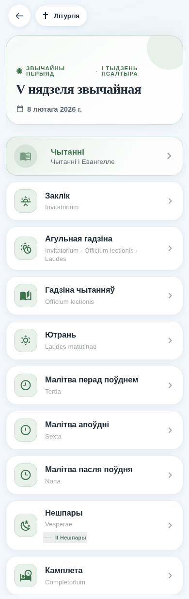
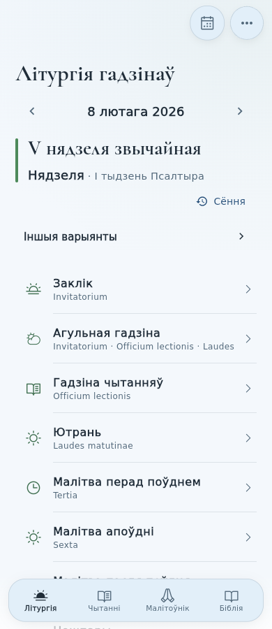
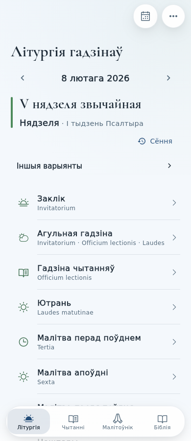
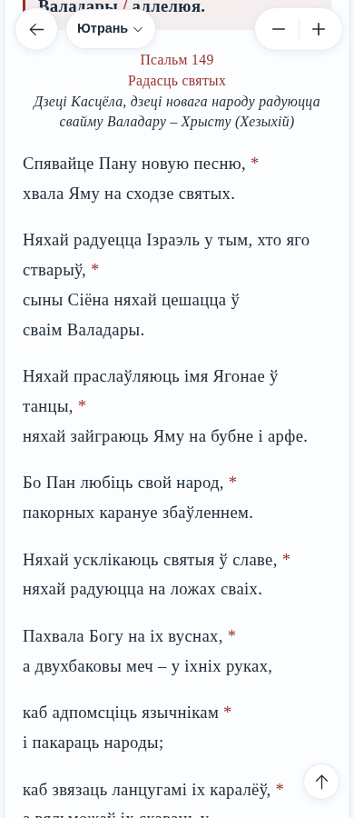
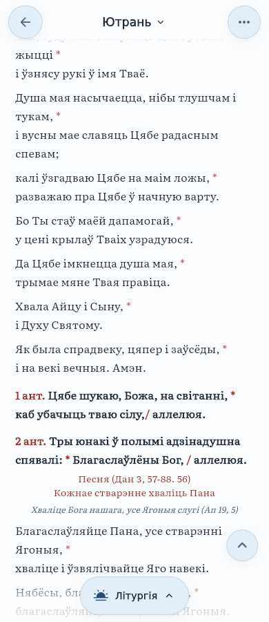
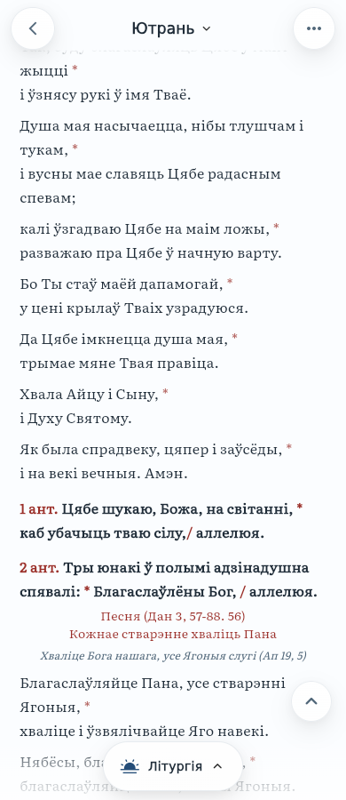
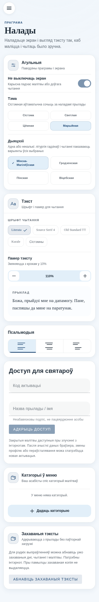
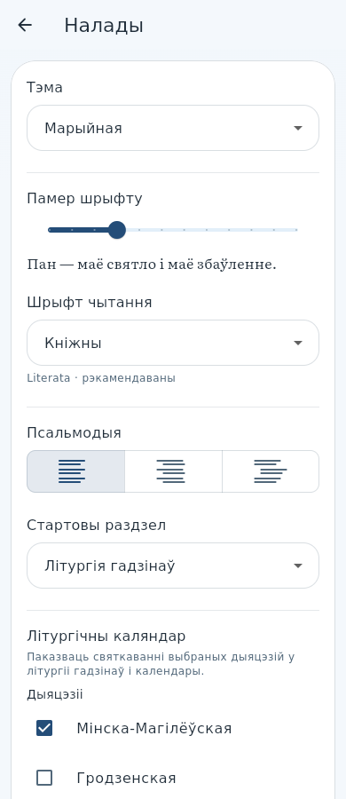
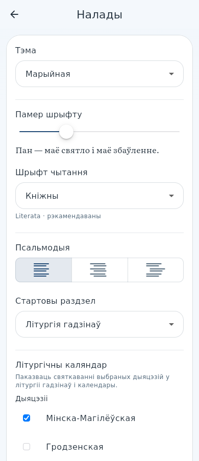

# Marian Flutter: визуальный аудит

Реализация: [описание архитектуры, палитры и пересечений PR](marian-theme-implementation.md).
Референс — утверждённый Web merge `3aa7ba0f5cd186922d67e4e5e18a980e287a030c`.
Финальная Flutter-база — `9bf2925` (включая принятые #64 и #62).
Финальные кадры сняты с активными Namespace/PID/Network и Seccomp-BPF sandbox:
[статус chrome://sandbox](../audit-evidence/marian-theme/chrome-sandbox.txt).
В этом контейнере SUID helper Chromium имеет неверного владельца; используется
штатный namespace-механизм с `--disable-setuid-sandbox`. Системные файлы
и разрешения helper не менялись. Пробные кадры пересняты в этом режиме.

## Окружение и метод

Flutter 3.41.4 / Dart 3.11.1, Linux, Chromium 154. Дата содержимого — 08.02.2026,
ширины 390 и 1440 px, высота 900 px. Дополнительно — 320×900, масштаб интерфейса
200% и максимальный Aa чтения. Android/iOS в таблицах ниже означают **Flutter Web
с Material/Cupertino-оформлением**, а не нативные сборки.

`tool/marian_theme_smoke.dart` использует настоящий `MyBrevApp`, production router,
реальные экраны и локальный content bundle. Firebase не инициализируется;
обновления и gateway заменены изолированными зависимостями, внешние запросы
блокируются. Начальная дата и выбранная тема задаются сценарием.

CanvasKit выдаётся из установленного SDK, внешний UI-font — локальный
DejaVu Sans (fallback вместо скачиваемого Roboto/Noto). Книжные шрифты берутся
из bundled assets. Это ограничивает сравнение с системной типографикой устройств;
расцветка, геометрия и виджеты Flutter настоящие.

Масштабирование в host сохраняет реальные размеры `FlutterView`; прежние
диагностические снимки с неправильным MediaQuery не входят в итоговую матрицу.
Ранние запуски двух Chrome-preview одновременно превысили лимит памяти окружения; итоговые
проверки выполняются с одним preview за раз.

## Что оценивалось

- Главная часов: холодный внешний фон, деликатное литургическое свечение,
  прежние цветные значки и маркер дня.
- Ютрань, Нешпары, Гадзіна чытанняў: начало, середина и конец, включая footer.
  Бумага однотонная, красные рубрики сохранены, fade у навигации функционален.
- Настройки: четыре полные подписи; на узком экране — dropdown,
  на широком — платформенный segmented control. Отдельно 320 px / 200%.
- Месячный календарь, модальная календарная панель, Библия.
- Light/Dark: сравнение старой палитры и существующей композиции с `main`.

## Web / Material / Cupertino — 390 px

Web-изображения скопированы без изменения из утверждённого merge-коммита;
веб-страница часов соответствует Flutter-главной часов по назначению.

| Сцена | Web Marian | Flutter Material preview | Flutter Cupertino preview |
| --- | --- | --- | --- |
| Главная часов |  |  |  |
| Середина Ютрани |  |  |  |
| Налады |  |  |  |

Цветовой характер совпадает: светлый холодный фон, почти белая бумага,
тёмный синий primary, спокойный secondary ink и красные рубрики. Flutter сохраняет
собственные списки часов, плавающую навигацию, размеры и книжную типографику.
Литургический зелёный остаётся небольшим смысловым акцентом; фон не перекрашен
в цвет периода. Cupertino-стекло светлее Material tonal controls: это
предусмотренная платформенная разница.

## Основные Flutter-сцены

| Сцена | Material 390 | Cupertino 390 | Material 1440 | Cupertino 1440 |
| --- | --- | --- | --- | --- |
| Главная | [PNG](../audit-evidence/marian-theme/android-390-marian-home.png) | [PNG](../audit-evidence/marian-theme/ios-390-marian-home.png) | [PNG](../audit-evidence/marian-theme/android-1440-marian-home.png) | [PNG](../audit-evidence/marian-theme/ios-1440-marian-home.png) |
| Ютрань — начало | [PNG](../audit-evidence/marian-theme/android-390-marian-laudes-start.png) | [PNG](../audit-evidence/marian-theme/ios-390-marian-laudes-start.png) | [PNG](../audit-evidence/marian-theme/android-1440-marian-laudes-start.png) | [PNG](../audit-evidence/marian-theme/ios-1440-marian-laudes-start.png) |
| Ютрань — середина | [PNG](../audit-evidence/marian-theme/android-390-marian-laudes-middle.png) | [PNG](../audit-evidence/marian-theme/ios-390-marian-laudes-middle.png) | [PNG](../audit-evidence/marian-theme/android-1440-marian-laudes-middle.png) | [PNG](../audit-evidence/marian-theme/ios-1440-marian-laudes-middle.png) |
| Ютрань — конец | [PNG](../audit-evidence/marian-theme/android-390-marian-laudes-end.png) | [PNG](../audit-evidence/marian-theme/ios-390-marian-laudes-end.png) | [PNG](../audit-evidence/marian-theme/android-1440-marian-laudes-end.png) | [PNG](../audit-evidence/marian-theme/ios-1440-marian-laudes-end.png) |
| Настройки и выбор тем | [PNG](../audit-evidence/marian-theme/android-390-marian-settings-options.png) | [PNG](../audit-evidence/marian-theme/ios-390-marian-settings-options.png) | [PNG](../audit-evidence/marian-theme/android-1440-marian-settings.png) | [PNG](../audit-evidence/marian-theme/ios-1440-marian-settings.png) |
| Календарь | [PNG](../audit-evidence/marian-theme/android-390-marian-calendar.png) | [PNG](../audit-evidence/marian-theme/ios-390-marian-calendar.png) | [PNG](../audit-evidence/marian-theme/android-1440-marian-calendar.png) | [PNG](../audit-evidence/marian-theme/ios-1440-marian-calendar.png) |
| Модальная панель | [PNG](../audit-evidence/marian-theme/android-390-marian-calendar-dialog.png) | [PNG](../audit-evidence/marian-theme/ios-390-marian-calendar-dialog.png) | [PNG](../audit-evidence/marian-theme/android-1440-marian-calendar-dialog.png) | [PNG](../audit-evidence/marian-theme/ios-1440-marian-calendar-dialog.png) |
| Библия | [PNG](../audit-evidence/marian-theme/android-390-marian-bible.png) | [PNG](../audit-evidence/marian-theme/ios-390-marian-bible.png) | [PNG](../audit-evidence/marian-theme/android-1440-marian-bible.png) | [PNG](../audit-evidence/marian-theme/ios-1440-marian-bible.png) |

Обычная молитва (Літанія да святога Юзафа), Парадак святой Імшы и чтения Мессы
также сняты в начале, середине и конце на обеих ширинах и платформах:
`{platform}-{width}-marian-{prayer|mass|readings}-{start|middle|end}.png`.
Основная бумага совпадает во всех этих reader-типах. Существующие семантические
подложки рефренов в Чтениях и красные рубрики остаются на месте.

Нешпары и Гадзіна чытанняў сохранены в той же папке:
`{android|ios}-{390|1440}-marian-{vespers|lectionis}-{start|middle|end}.png`.
Все три режима псалмодии проверены на каждой платформе и ширине.
Основные кадры Ютрани используют принятый в #62 `leftBreak`; дополнительные
`{platform}-{width}-marian-psalmody-{leftBreakIndent|alternatingStanzas}.png`
показывают второй отступ и чередование строф. Цвет бумаги и рубрик сохраняется.

Сравнения обычной светлой и тёмной:
`{platform}-{width}-{light|dark}-{home|laudes-middle|settings}.png`.

## Проверки

Окончательные машинные результаты —
[`visual-result.json`](../audit-evidence/marian-theme/visual-result.json),
[`targeted-test.log`](../audit-evidence/marian-theme/targeted-test.log),
[`full-test.log`](../audit-evidence/marian-theme/full-test.log),
[`analyze.log`](../audit-evidence/marian-theme/analyze.log).
Матрица Flutter содержит **129 PNG**: 105 Marian и 24 Light/Dark. Все размеры MediaQuery соответствуют
viewport; все проверенные ReaderContentSurface имеют `#FBFDFF`. В середине и
конце трёх часов на обеих ширинах и платформах точки чистого поля страницы
дают один и тот же RGB `(251,253,255)` без цветных пятен.
[Численные проверки и контраст](../audit-evidence/marian-theme/audit-checks.json).

Контраст на бумаге: основной текст **13,77:1**, вспомогательный **5,69:1**,
primary **8,55:1**, рубрики **7,23:1**. Новая палитра проходит AA.

На 320 px / 200% четыре подписи темы целиком видимы в dropdown. Обнаруженное
переполнение на 92 px относится к существующему
`DropdownButtonFormField<String>` с ключом `settings-start-section`:
это поле «Стартовы раздзел», ниже нового переключателя. На чистом `9bf2925` воспроизвелось то же переполнение 92 px:
[baseline/errors.json](../audit-evidence/marian-theme/baseline/errors.json),
[main PNG при 200%](../audit-evidence/marian-theme/baseline/android-320-light-settings-200.png).
Это существующее ограничение старого поля; новый переключатель темы не переполняется.
При одновременных 200% и максимальном Aa на 320 px заголовок «Ютрань»
переносится на две строки и выходит за компактную область верхней навигации
([PNG](../audit-evidence/marian-theme/android-320-marian-reader-200.png)).
Это ограничение существующей фиксированной reader-chrome: её геометрия,
типографика и размеры в ветке совпадают с main. Отдельный pixel baseline
этого reader-состояния не снимался; для него подтверждена неизменность исходников.
Оно требует отдельной проверки доступности перед мобильным релизом.

Сравнение с неизменённым `main`: 24 пары PNG (home / середина Ютрани / settings,
Light/Dark, обе ширины и платформы). **20 пар пиксельно идентичны**.
Четыре широких settings отличаются только переключателем с четвёртым вариантом
темы. Все восемь главных страниц и все восемь страниц чтения Light/Dark
пиксельно совпадают. [PNG main](../audit-evidence/marian-theme/baseline/),
[попарные результаты](../audit-evidence/marian-theme/audit-checks.json).
Полный ColorScheme и IbColors также проверяются по снимку до изменения темы.

### Итоги тестов

| Проверка | Результат |
| --- | --- |
| `dart format --output=none --set-exit-if-changed` по изменённым Dart-файлам | PASS, 19 файлов, 0 изменений |
| `flutter analyze --no-pub` | 0 errors / warnings, те же 12 исходных info; exit 1 из-за info |
| `flutter analyze --no-pub --no-fatal-infos` | PASS, exit 0 |
| Целевые unit/widget, повтор на финальной базе | **123 passed**, exit 0 |
| Полный `flutter test --no-pub --concurrency=2 --reporter expanded` | **1835 passed, 9 skipped, 1 failed**, 23:57, exit 1 |
| Новые тесты Marian в полном наборе | **16 passed**, без новых пропусков |
| Native Android / iOS | NOT RUN, нет SDK / Xcode / устройств |

[Структурированные результаты](../audit-evidence/marian-theme/test-results.json),
[лог analyzer с исходными info](../audit-evidence/marian-theme/analyze-no-fatal-infos.log),
[сохранность domain/reader-файлов и всех assets](../audit-evidence/marian-theme/source-contracts.json).

Единственное падение полного набора отдельно проверено на неизменённом
`main` **9bf2925**:

| Тест | Ветка / main | Подтверждение |
| --- | --- | --- |
| `Hours cards and assemblies equal the web, 2025–2035 × 4 dioceses` | То же расхождение `feast-christthehighpriest`; весь показанный список несовпадений идентичен | [main](../audit-evidence/marian-theme/main-hours-parity-test.log) |

Тест паритета и fixture не менялись. Ошибки исправления ORDO из принятого #64
в финальном прогоне не повторились. Порог тайм-аутов, тексты, fixture и
производственные календарные алгоритмы ради зелёного результата не менялись.
Полный набор не объявляется зелёным.

`Readings date_navigation: three day arrows, once` падал в предыдущем полном
прогоне на базе 6b74fbe и отдельно воспроизвёлся на чистом 9bf2925
([лог main](../audit-evidence/marian-theme/main-date-hint-test.log)). В финальном
полном прогоне ветки этот нестабильный тест прошёл; он не входит в число её падений.

Предыдущие завершённые результаты на базе 6b74fbe (1735 passed, 9 skipped,
2 failed; 36 целевых passed) сохранены в
[`previous-base-6b74fbe/`](../audit-evidence/marian-theme/previous-base-6b74fbe/).
Первый baseline-прогон на 7abba85 остановился при выключении окружения;
промежуточный прогон старой базы был прерван при включении принятого #64.
Эти прерванные логи не используются как завершённый полный набор.
Финальные числа относятся к `full-test.log` на базе **9bf2925**.

## Ручная проверка Android

1. В «Налады» выбрать «Марыйная»: фон голубоватый, элементы управления синие,
   подпись целиком. Перезапустить приложение: выбор и прочие настройки сохранены.
2. При включённой тёмной теме ОС Marian остаётся светлой, status/navigation icons
   тёмные. Выбрать «Сістэма» и сменить яркость ОС: приложение должно следовать ей.
3. Открыть Ютрань, прокрутить псалмы и завершение, затем Нешпары и Гадзіну чытанняў:
   единая бумага без цветных пятен, красные рубрики, читаемые края под навигацией.
4. Из чтения открыть настройки, сменить тему и вернуться: тот же час и место
   прокрутки. Проверить Aa, привычный шрифт и все три режима псалмодии: переключение темы
   сохраняет выбранный режим и его форматирование.
5. Проверить календарь, модальную панель, обычную молитву, чтения Мессы и Библию;
   повторить на малой ширине с системным текстом 200% и после холодного запуска.

Нативный Android/iOS smoke не выполнен: Android SDK и Xcode отсутствуют.
Он нужен перед мобильным релизом, особенно для edge-to-edge system bars,
SafeArea, реального blur, TalkBack/VoiceOver и производительности прокрутки.
Слияние PR, deploy, store release и изменения Firebase не выполнялись.

## Воспроизведение Chrome

Основной host: `flutter run -d chrome -t tool/marian_theme_smoke.dart
--web-port 5241`. В этом Linux-контейнере к нему добавлены
`--web-browser-flag=--headless=new`, `--web-browser-flag=--disable-dev-shm-usage`
и `--web-browser-flag=--disable-setuid-sandbox` при проверенной namespace sandbox.
На обычной рабочей машине достаточно штатного Chrome с его sandbox.

После запуска: `node audit-evidence/marian-theme/capture-matrix.cjs <Chrome-CDP-port>`.
CDP-порт находится в строке запущенного Chromium `--remote-debugging-port`;
это отдельный порт от Flutter VM Service. Сценарий подключается к уже
запущенному браузеру и точному `http://localhost:5241/`.
Сценарий поддерживает разделение через `AUDIT_PLATFORMS=android`, затем
`AUDIT_PLATFORMS=ios AUDIT_RESUME=1`. Итоговая матрица снята последовательно
в одном Chrome. `capture-psalm-middle.cjs <Chrome-CDP-port>` уточняет
одинаковое место первого длинного псалма во всех темах и трёх режимах.
При ручной перезагрузке debug-вкладки сценарий однократно вызывает
зарегистрированный `$dartRunMain`, если DWDS ещё не запустил приложение.
Старые восстановленные audit-вкладки закрываются, чтобы не удерживать Hive.
Сообщения DWDS «Not connected to an application» сохранены отдельно в
`visual-result.json → transportErrors`: это debug-подключение, а не исключения
Flutter-виджетов. Исходный console-сводный лог — `capture-final.log`.
Финальные 129 записей содержат отметку `namespace+seccomp-bpf`.

Для baseline нужен отдельный worktree `9bf2925` с теми же зависимостями:
[точный baseline host](../audit-evidence/marian-theme/baseline-host.dart.txt)
копируется в его `tool/marian_theme_smoke.dart`. Production-файлы main не
меняются. Он запускается на порту 5242, затем
`AUDIT_BASE_URL=http://localhost:5242 AUDIT_OUTPUT_DIR=<baseline-output>
node audit-evidence/marian-theme/capture-baseline.cjs <Chrome-CDP-port>`.
При разделении платформ используется `AUDIT_PLATFORMS` и `AUDIT_RESUME=1`.

Скрипты рассчитаны на установленный SDK `/workspace/toolchains/flutter`,
Playwright и локальный `/usr/share/fonts/truetype/dejavu/DejaVuSans.ttf`.
`check_evidence.py` использует Pillow для чтения PNG, сверки чистой бумаги
и попарного сравнения; `verify_source_contracts.py` проверяет Git blobs
неизменённых reader/domain-файлов и отсутствие изменений всех assets.
