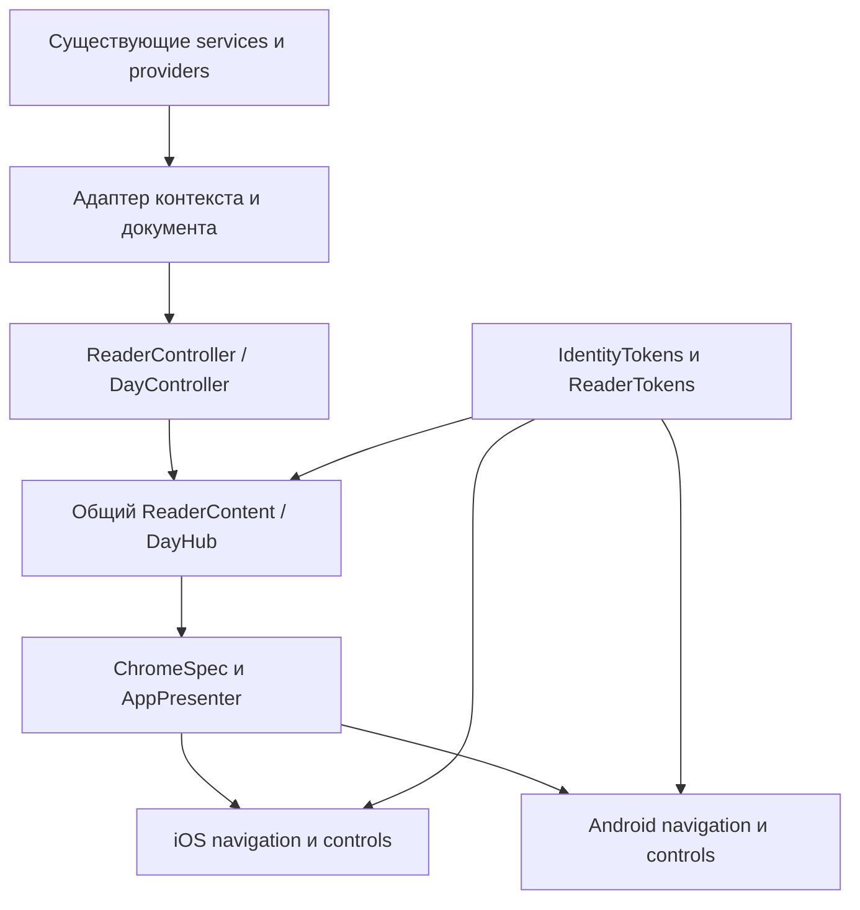

# iBreviary: аудит мобильного UI и направление развития

Дата: 7 сентября 2026 года. Статус: предложение системы до реализации.

Главный вывод: приложение уже содержит полезную предметную и читательскую основу, но объединяет несколько конкурирующих способов организации интерфейса. Новый слой оформления следует строить вокруг литургического документа, контекста дня и предсказуемой навигации. Замена blur, радиусов и иконок внутри прежней композиции проблему не решит.

## Основание и границы аудита

Изучены маршруты, все 17 экранов Flutter, общие widgets и theme, связанные providers/services, существующая документация платформенного дизайна и UI-тесты. MyBrev изучен как функциональный референс: маршруты, Default/One layouts, ItemsList, OrasList, OraBar, навигация дня, ReadingsView, выборы вариантов и структура читательского контента. Административные возможности PWA не входят в предлагаемую мобильную архитектуру.

Это аудит исходного кода и реализованных контрактов UI. Нативные сборки на iPhone/Android и визуальная проверка экранов в этой сессии не выполнялись. Поэтому ниже различаются подтверждённые свойства кода, их UX-интерпретация и риски для проверки на устройствах. Плавность, фактическое перекрытие текста при прокрутке и работа VoiceOver/TalkBack не объявляются проверенными.

Локальная среда: Flutter 3.41.4, Dart 3.11.1. Пройдены 5 существующих widget-тестов из `platform_design_test.dart`, `text_scale_control_test.dart`, `alternative_text_test.dart`. `flutter analyze --no-pub` завершился без замечаний. Проверки подтверждают платформенные ветки контролов и отдельные взаимодействия, но не качество Liquid Glass, доступность всего приложения или корректность всех экранов при крупном шрифте.

Код приложения и MyBrev не изменялись. На момент начала аудита уже существовало изменение `lib/screens/prayers_screen.dart`; оно учитывалось как текущее состояние и сохранено.

## 1. Что переносить из MyBrev

Сохранить предметную последовательность:

1. Выбрать гражданскую дату.
2. Понять литургический день и доступные празднования.
3. Выбрать допустимый вариант дня/официй.
4. Открыть час или чтения с тем же контекстом.
5. Читать последовательный документ с рубриками, антифонами, ответами и альтернативами.

Сохранить автоматический выбор актуального цикла чтений, доступ к другим циклам, поиск по периоду/неделе/празднику, белорусские названия и латинские уточнения часов. Сохранить независимость рубрик от сезонного акцента, форматирование псалмов, избранное и читательские настройки.

Не считать обязательными для Flutter плавающий hamburger, композицию из нескольких круглых кнопок, нижний web-dock, крупные hero-карточки, CSS-подобные вложенные поверхности и идентичные отступы PWA. Их функциональные задачи сохраняются, а мобильная форма выбирается заново. Качество PWA этим аудитом не оспаривается.

Два расхождения с заданным назначением:

- Flutter не содержит отдельной админки, но содержит локальный редактор молитв, создание/удаление личных молитв и управление категориями. Это пользовательское редактирование, а не администрирование Firestore. Для строго читательского продукта создание и редактирование текста следует исключить из основной навигации. Существующие пользовательские данные при миграции не удалять; избранное и личная организация чтения могут остаться.
- Полная offline-доступность всего корпуса сейчас не следует из реализации. `CacheWarmupService` загружает окно −7/+30 дней и расширяет его до −14/+60; часть коллекций синхронизируется целиком. Нужен явный контракт полноты: какие документы и зависимости считаются установленным корпусом. UI не должен показывать «всё доступно offline» по одному событию завершения warmup.

Целевое требование принимается без ослабления: после полной синхронизации весь предусмотренный мобильным продуктом контент должен работать без сети. Текущее окно дат — обнаруженное ограничение реализации, а не предлагаемая замена этому требованию. Доработку полноты синхронизации следует выделить как зависимость offline UX; в рамках этого аудита сервисы не переписываются.

## 2. Аудит экранов и основных компонентов

### AppShell и глобальная навигация

**Удачно.** Общая оболочка уже выделена. Есть SafeArea/insets, общий запуск подготовки данных, единый фон и отделение маршрутов чтения от части корневых экранов.

**Проблема.** `AppShell` одновременно отвечает за drawer, сеть, материалы, ручной верхний отступ и исчезновение нижней панели. Верх резервируется как `topPadding + 78`, а для `/prayers` есть специальная ветка. Это зависимость геометрии оболочки от конкретной страницы. Внизу нет устойчивой карты разделов: панель видна главным образом на `/` и `/picker`, разделы находятся в drawer.

**Сохранить.** Роль оболочки, единый маршрутный вход, подготовку данных вне конкретного экрана чтения.

**Заменить.** Строковые исключения маршрутов и ручную раскладку на контракты корневого, вложенного и читательского экранов. Ввести постоянные основные направления с подписями. Hamburger не должен быть единственным способом обнаружить основные функции.

**Адаптировать.** Представление основных вкладок, верхней панели, обратного перехода и системных областей. **Общее:** состав разделов, смысл маршрутов, сохранение контекста и ожидаемый результат Back.

Опора: [AppShell](../lib/widgets/app_shell.dart), [router](../lib/router/router.dart), [drawer](../lib/widgets/navigation_drawer.dart).

### AppBottomNav / ReadingsBottomNav и управление датой

**Удачно.** Доступны соседние дни, возврат к сегодняшнему и календарь; Hours/Readings используют общую реализацию.

**Проблема.** Три элемента одной капсулы имеют разную семантику: открыть каталог, выполнить «Сегодня», показать диалог. При этом selectedIndex изображает переключение разделов. Выбор «календаря» фактически означает «открыта другая дата», даже если календарь закрыт. Подписей на экране нет. По краям добавлены ещё две самостоятельные круглые поверхности.

Readings переключает дату через `context.go`, а Hours изменяет `selectedDateProvider`. Drawer и часть chrome продолжают получать дату/цвет из глобального provider. Следовательно, после переходов существует путь к несовпадению даты открытого документа и контекста общего меню. Это дефект контракта состояния, а не только внешний вид.

**Сохранить.** Команды Previous/Next/Today/PickDate. **Убрать.** Имитацию tab bar вокруг этих команд и отдельную поверхность для каждой стрелки.

**Решение.** Разделить `PrimaryNavigation` и `DayNavigator`. Первый переключает разделы; второй показывает читаемую дату и локальные команды дня. На корневом экране DayNavigator располагается рядом с контекстом дня. В документе смена дня доступна как контекстное действие, без конкурирующей глобальной панели.

Автоскрытие сейчас реагирует на накопленные 12 logical pixels и реализовано дважды. Это может отвлекать при небольших корректирующих движениях. Основные вкладки оставить стабильными. Для чтения предусмотреть отдельную политику сворачивания chrome с доступным способом его вернуть.

Опора: [bottom_nav.dart](../lib/widgets/bottom_nav.dart), [ReadingsScreen](../lib/screens/readings_screen.dart), [liturgical_provider.dart](../lib/providers/liturgical_provider.dart).

### HomeScreen: выбор даты и дня

**Удачно.** Отдельно представлены дата и допустимые литургические варианты; названия и контекст доступны до открытия документа. Соседние даты меняются предсказуемыми командами.

**Проблема.** Карточка календаря высотой 190, большой день недели, декоративный круг, капсула «Змяніць», затем заголовок списка и карточки вариантов расходуют значительную часть первого экрана до доступа к часу. Слово «фіксаванае» описывает происхождение данных, а не обязательно полезное читателю различие. Ещё один экран Hora повторяет часть метаданных.

**Сохранить.** Полные названия празднований и явный выбор альтернатив. **Убрать.** Обязательный большой календарный hero и технические метки источника. Дату оставить компактной, но явно интерактивной.

Предлагаемый `DayHub`: дата → выбранное празднование → часы и чтения. Для однозначного дня сразу показывать часы. При значимом выборе празднования сохранять явный шаг выбора; не назначать произвольный вариант ради уменьшения числа нажатий. Основание выбора берётся из существующей литургической логики.

**Общее:** порядок и смысл информации. **Адаптивное:** верхний заголовок и механизм выбора даты/варианта.

Опора: [home_screen.dart](../lib/screens/home_screen.dart).

### HoraPickerScreen: выбор часа

**Удачно.** Стабильный список часов, белорусское имя и латинское уточнение, вход в чтения выбранного дня. Основной день появляется до дополнительной загрузки ссылок чтений — это полезная последовательность.

**Проблема.** Каждый час получает отдельную GlassSurface, рамку, тень и крупный контейнер иконки. Все пункты почти одинаково акцентированы. Большая карточка дня повторяет уже пройденный выбор. Недоступность определяется наличием полей, но UI показывает просто неактивный пункт: нельзя понять, отсутствует ли текст в кэше или этот час не предусмотрен.

**Сохранить.** Каталог часов, проверку доступности как основу, ссылки на чтения и варианты официев. **Заменить.** Стопку отдельных плиток на спокойный сгруппированный список; добавить смысловую причину недоступности. Важные уточнения вроде I/II Нешпараў показывать в контексте часа. Не переписывать правила вечерни внутри визуальной миграции.

**Общее:** порядок часов и предметная семантика. **Адаптивное:** list rows, pressed state, шевроны, выбор вариантов.

Опора: [hora_picker_screen.dart](../lib/screens/hora_picker_screen.dart), [hora_items.dart](../lib/constants/hora_items.dart).

### LiturgicalPickerScreen / LiturgicalDayOptionsScreen

**Удачно.** Сохранён альтернативный вход для опытного пользователя: периоды, праздники, неделя, день, год. Не нужно знать гражданскую дату.

**Проблема.** Экран совмещает режим, год, вкладки и несколько типов выбора. Ряд до 34 недель — длинный горизонтальный набор chips. На iOS здесь остаются Material TabBar, DropdownButton и showModalBottomSheet. Выбор периода и промежуточный экран чтения/часов создают дополнительные уровни. Для выбора года задан отдельный диапазон 2019–2030, не связанный с доступностью offline-контента.

**Сохранить.** Весь предметный поиск. **Упростить.** Сделать его вторичным действием «Знайсці літургію» рядом с календарём; выбирать неделю через обозримую сетку или список. Результат должен возвращать выбранный контекст дня/документа, а не самостоятельно решать маршрут из глубины sheet.

**Общее:** фильтры и найденные результаты. **Адаптивное:** segmented control, presentation sheet, выбор года. Месячный календарь и поиск по литургическому периоду остаются разными задачами, даже если имеют общий вход.

Опора: [liturgical_picker_screen.dart](../lib/screens/liturgical_picker_screen.dart), [liturgical_day_options_screen.dart](../lib/screens/liturgical_day_options_screen.dart).

### OraScreen

**Удачно.** Основной текст уже идёт непрерывно, без карточки вокруг каждого абзаца. Есть рубрики, форматирование псалмов, альтернативы, синхронизация повторных антифонов, варианты Invitatorium и логика вечерни. Это основа продукта, которую нужно беречь.

**Проблема.** Файл около 1 569 строк одновременно загружает данные, разрешает вечерню, собирает структуру часа, определяет HTML-стили и создаёт экран. `ReadingScaffold` передаёт только TextStyle; общий контракт читателя фактически отсутствует. Метаданные дня заключены в стеклянную карточку. Основной текст не ограничен по ширине. Нет явной модели восстановления позиции по документу/разделу. Ветка HTML и SelectableText дают разные возможности выделения. Разделы сформированы заранее в Column.

Здесь же `ColorScheme.primary` заменяется цветом дня, но согласованная пара `onPrimary` не пересчитывается. Сезонный акцент начинает управлять системными состояниями выбора и кнопками. `_dayFuture` создаётся один раз; ошибка показывает техническое сообщение без локального Retry. Добавление заголовка до проверки `sections.isEmpty` делает эту проверку неэффективной для пустого содержимого часа.

**Сохранить.** Семантику текста, порядок разделов, проверенные утилиты, контроллеры альтернатив. **Заменить.** Контейнер экрана и локальные стили на `ReaderScreen`, `ReaderDocument` и единый renderer. Заголовок дня сделать типографическим блоком; подробности раскрывать по запросу.

**Общее:** документ, шрифт чтения, рубрики, восстановление места, альтернативы. **Адаптивное:** Back, toolbar, Aa, меню разделов, выделение и системные меню. Визуальная миграция не должна редактировать сам литургический текст.

Опора: [ora_screen.dart](../lib/screens/ora_screen.dart), [reading_scaffold.dart](../lib/widgets/reading_scaffold.dart), [alternative_text.dart](../lib/widgets/alternative_text.dart).

### ReadingsScreen / ReadingDetailScreen

**Удачно.** Чтения сгруппированы по празднованию; актуальный цикл выбирается автоматически. Различаются чтение, псалом, Евангелие, ссылки, припевы и заключительные формулы. Основное полотно уже значительно спокойнее карточных экранов выбора.

**Проблема.** ReadingsScreen около 1 667 строк содержит собственные загрузку, группировку, табы, drawer, автоскрытие и несколько копий Scaffold. Экран открывается из Hora через push, но ведущая кнопка принудительно остаётся «Меню», а не «Назад». В PWA есть явный возврат «Літургія» с контекстом дня; в Flutter этот сценарий ослаблен.

Перед текстом могут стоять одновременно заголовок панели, крупное «Чытанні», дата, выбор празднования, панель цикла с объяснением, название чтений и ещё одна метка цикла. Циклы оформлены как TabBar/TabBarView, хотя являются вариантом одного документа. Есть искусственная задержка 32 ms перед загрузкой для показа spinner. HTML-ритм отличается от Ora. ReadingDetail дополнительно предлагает «Паказаць HTML» — техническую функцию вне назначения читательского приложения.

**Сохранить.** Группировку и автоматический выбор цикла; доступ к альтернативным циклам и полноту текста. **Убрать.** Дублирование метаданных, обязательную панель всех циклов перед документом и просмотр raw HTML из production UI. **Заменить.** Оболочку на тот же ReaderScreen; текущий цикл показывать компактно с явным выбором другого. Не скрывать возможности настолько, чтобы их нельзя было обнаружить.

**Общее:** правила выбора группы/цикла, представление разделов текста. **Адаптивное:** выбор цикла/празднования, возврат, menu/sheet. Readings как корневой раздел имеет корневую навигацию; те же чтения, открытые из дня, имеют источник возврата. Данные и renderer при этом одни.

Опора: [readings_screen.dart](../lib/screens/readings_screen.dart), [reading_detail_screen.dart](../lib/screens/reading_detail_screen.dart), PWA `src/layouts/default/Default.vue` и `src/components/readings/ReadingsView.vue`.

### Headers, floating controls и navigation controls

**Удачно.** `AdaptiveAppBar` централизует действия и использует платформенную иконку Back. В теме предусмотрены Cupertino/PredictiveBack transitions. Основные touch-кнопки обычно имеют размер 48–56.

**Проблема.** `AdaptiveAppBar` — одна Row высотой 48 с отличающимся выравниванием, а не два полноценных навигационных поведения. Заголовок находится над прокручиваемым контентом без общей защиты зоны чтения; верхний padding защищает старт документа, но не текст, который затем прокручивается под заголовок. Риск наложения необходимо проверить визуально. Центр iOS вычисляется внутри оставшегося места, а не гарантированно относительно экрана. Определение Aa через `whereType<TextScaleControl>()` связывает инфраструктуру панели с конкретным виджетом.

Есть три конкурирующих механизма: собственная кнопка AppShell, AdaptiveAppBar и FloatingTopActions. Последний по поиску не используется остальными файлами lib и содержит жёсткий iOS-chevron даже для иной платформы. BibleChapter также жёстко задаёт iOS-chevron и переход на `/`, несмотря на смысл Back.

**Сохранить.** Именованные действия, поддержку системных переходов и единый вход настройки текста. **Заменить.** Контракт на `ChromeSpec(title, backTarget, actions, readingMode)` и платформенные implementations. Заголовок в документе и компактный заголовок при прокрутке должны сменять роли, а не повторять друг друга всё время.

Опора: [adaptive_app_bar.dart](../lib/widgets/adaptive_app_bar.dart), [floating_top_actions.dart](../lib/widgets/floating_top_actions.dart), [main.dart](../lib/main.dart).

### Cards, surfaces, blur, радиусы и elevation

**Удачно.** Появились централизованные материалы и нейтральная палитра. Android-ветка AdaptiveChromeSurface действительно использует непрозрачную тональную заливку.

**Проблема.** GlassSurface остаётся универсальным контейнером контента и используется на Android, в том числе в календарном диалоге, поиске молитв и чтении Библии. Поэтому утверждение «blur только на iOS» неверно для всего дерева UI. У pill исходная opacity примерно 97%, у card — 94%, но за ними всё равно выполняется BackdropFilter. Это дополнительные фильтры с ограниченным визуальным эффектом; влияние на кадры нужно измерить, а не предполагать.

Набор радиусов распределён по файлам: 13, 16, 17, 18, 20, 22, 24, 26, 28, 30, 32, 999. Разные значения сами по себе допустимы, но здесь они не описывают устойчивые роли. Вложенные рамка, тонировка, тень, иконка в отдельной рамке создают равный визуальный вес у действий и данных. Pill-тени доходят до blur 30 и offset 10; для повторяющихся небольших элементов это избыточная глубина.

**Сохранить.** Нейтральные светлую/тёмную поверхности, мягкий характер геометрии и возможность небольшого сезонного акцента. **Заменить.** GlassSurface как универсальную основу на `ContentSurface`, `GroupedListSurface`, `ReaderCanvas` и платформенные chrome-материалы. Текстовый документ — непрозрачное полотно без blur и общей карточной рамки.

**Общее:** иерархия поверхностей и спокойный характер. **Адаптивное:** точная геометрия системных контролов, материалы, pressed state и elevation. Одинаковые капсулы на обеих ОС не являются необходимым условием единой идентичности.

Опора: [glass.dart](../lib/theme/glass.dart), [platform_design.dart](../lib/theme/platform_design.dart), [platform-design.md](platform-design.md).

### Dialogs, sheets и date selection

**Удачно.** Единый date-picker API с nullable-результатом; календарь Android и Cupertino wheel iOS. Есть отмена, подтверждение, Today; у настройки текста тоже две presentation-ветки.

**Проблема.** Адаптация непоследовательна: period/week, фильтр молитв, поиск Библии и часть настроек используют Material dialogs/sheets на обеих ОС. Android-календарь обёрнут в GlassSurface. В iOS Aa нарисован drag handle, хотя это showCupertinoModalPopup без реализованного здесь поведения перетягивания. У date popup одна тесная горизонтальная строка Cancel/Title/Done; узкую ширину и крупный текст нужно проверить. Wheel нативен как тип контрола, но хуже месячной сетки помогает найти ближайшее воскресенье.

**Сохранить.** Один контракт выбора даты, Today и отмену без изменения дня. **Заменить.** Разрозненные вызовы на `AppPresenter`: выбор, подтверждение, справка, настройки чтения. На iOS оценить inline-календарь в sheet для обзора месяца; wheel оставить для задачи точного ввода, если это подтвердит прототип. На Android использовать Material date picker с непрозрачной поверхностью. Доступность текста для даты должна быть видна, а диапазон — согласован с продуктовым контрактом.

**Общее:** модель draft/commit, результаты, названия, ошибки. **Адаптивное:** форма sheet/menu/dialog, закрытие, высота, жесты, кнопки.

Опора: [ambient_date_picker.dart](../lib/widgets/ambient_date_picker.dart), [text_scale_control.dart](../lib/widgets/text_scale_control.dart), [liturgical_picker_screen.dart](../lib/screens/liturgical_picker_screen.dart).

### Font-size controls и typography

**Удачно.** Единое сохранённое значение fontSize; Aa доступен непосредственно в читателях. В панели есть проценты, slider, шаги и semantics. UI-шрифт уже отделён от шрифта чтения. ReaderTheme выделяет ink, muted, rubric и display.

**Проблема.** «Сістэмны» фактически превращается в Literata в ReaderTheme, а настройки демонстрируют системный шрифт. Пользовательский выбор и реальный результат не совпадают. UI на обеих платформах принудительно оформлен Source Sans 3, что ослабляет системный характер навигации iPhone. Настроечный список содержит display-гарнитуру наряду со шрифтами для длительного чтения без объяснения различий.

Базовый размер чтения 16; при 70% получается 11.2. Основной текст имеет height 1.65, HTML Ora — 1.75, Readings — 1.78; межабзацные отступы тоже разные. Системное увеличение текста не запрещено явно, но нет единой стратегии для его сочетания с пользовательским масштабом и HTML. Отсутствие специальных обработчиков не означает, что Flutter вообще не масштабирует Text.

GoogleFonts используется динамически, файлы шрифтов не объявлены среди bundled assets. На чистой offline-установке выбранная типографика поэтому не гарантируется кодом. Кэш прошлых запусков не заменяет поставку шрифта вместе с приложением.

**Сохранить.** Aa, настройки, роли текста, традиционную рубрикацию. **Заменить.** «Сістэмны» на честное поведение или название «Кніжны» для выбранного serif. Выбрать одну основную читательскую гарнитуру с белорусской кириллицей и встроить необходимые начертания. Source Sans/Cormorant не закреплять как обязательные системные шрифты обеих ОС.

Для прототипа: reader body 18 logical px, line-height около 1.55–1.65, ширина по удобной длине строки, мобильные поля 16–20. Это стартовые параметры для чтения реальных текстов, не утверждённый стандарт. UI на iOS — системная типографика, Android — Material type scale; читательский serif и смысловые роли одинаковы.

Опора: [reader.dart](../lib/theme/reader.dart), [settings_provider.dart](../lib/providers/settings_provider.dart), [settings_screen.dart](../lib/screens/settings_screen.dart), [pubspec.yaml](../pubspec.yaml).

### Loading / offline / error states

**Удачно.** Есть кэш, автоматическая подготовка, загрузка в фоне, retry чтений, placeholders и прогресс синхронизации. Их не нужно заменять сетевой архитектурой заново ради UI.

**Проблема.** Красный баннер отсутствия сети отображается в AppShell независимо от доступности текста; в читательских маршрутах оболочка другая. «Нет данных» часто отсылает в настройки без действия на месте. Ошибка Ora и ошибка Readings оформлены по-разному, технические исключения попадают на экран. Тип shimmer в Ora изображает карточный список, хотя результат — документ. Connectivity отражает наличие сетевого интерфейса, а не полноту локального корпуса или успешность синхронизации.

`main()` выполняет несколько операций до runApp; у этого этапа нет собственной ошибки/восстановления Flutter-экрана. Существующий native splash сам по себе не сообщает, что происходит. Это отдельный UX-риск первого запуска.

**Решение — два независимых измерения:** доступность документа и фоновое обновление. Загруженный документ остаётся открытым и при offline, и при неудавшемся обновлении.

| Состояние | Что видит читатель | Действие |
| --- | --- | --- |
| Документ установлен, сети нет | Обычный текст; необязательная тихая отметка offline | Продолжает читать |
| Документ установлен, обновляется | Текст без замены spinner | Обновление в фоне |
| Обновление не удалось, текст есть | Сохранённый текст; сообщение в разделе загрузок | Повторить обновление там |
| Нужный документ ещё не установлен | Название документа и понятная причина | Скачать при наличии сети / открыть доступное |
| Первая установка без данных и сети | Экран подготовки с конкретным объяснением | Повторить после подключения |
| В корпусе действительно нет нужного текста | Предметное сообщение | Вернуться к вариантам, открыть допустимый доступный текст |
| Данные не удалось прочитать | Краткая ошибка без stack trace | Повторить / восстановить загрузку |

Не подменять «не скачано» утверждением «в литургии отсутствует». В settings показывать объём/состав установленных материалов и завершённость, а имена коллекций, docCount и диагностический raw error перенести в диагностику.

### Литургические цвета

**Удачно.** Основная палитра нейтральная, рубрики имеют отдельные красные токены. Существуют централизованные правила акцента дня, поправка яркости части акцентов в dark mode и тематические тесты.

**Проблема.** Функция `liturgicalColorForDay` одновременно кодирует период, ранг и тематические ассоциации по словам в названии. Это UI-эвристика, не доказанный источник канонического цвета облачений. Её результат используется и для подложки, и для мелкого текста, и для primary. Подъём светлоты применяется не везде. Цвет chrome часто берётся от первого варианта глобально выбранного дня, тогда как документ относится к другому празднованию.

Расчёт для конкретных непрозрачных токенов показывает риск: `#4D8A5B` на `#FAFAFA` ≈ 3.94:1; `#BD8A24` ≈ 2.95:1; `#6F4A92` на `#151515` ≈ 2.67:1. Это расчёт пар цветов, не замер скриншотов всех tinted surfaces. Для сравнения, рубрика `#9B302A` на `#FAFAFA` ≈ 7.06:1. Для обычного текста ориентир WCAG — 4.5:1: [W3C, Contrast Minimum](https://www.w3.org/WAI/WCAG22/Understanding/contrast-minimum.html).

**Сохранить.** Смысловое цветовое различение, отдельную рубрику, спокойную базу. **Заменить.** Прямое использование raw color на роли `liturgicalMarker`, `liturgicalTint`, `onLiturgicalTint`, `rubric`, `uiAccent`, `error`. Цвет берётся из контекста открытого документа; сезонная заливка не изменяет системный primary. Белый/золотой литургический маркер не обязан превращаться в золотой мелкий текст.

**Общее:** семантика и контекст цвета. **Адаптивное:** отображаемый тон, контраст на материале, системные акценты. Dynamic color Android допустим для интерфейсных поверхностей, но не перекрашивает рубрики и литургические значения.

Опора: [liturgical_theme.dart](../lib/utils/liturgical_theme.dart), [app_theme.dart](../lib/theme/app_theme.dart), [liturgical_provider.dart](../lib/providers/liturgical_provider.dart).

### Spacing, accessibility и animations

**Удачно.** Многие размеры касания достаточны; есть tooltips, отдельные Semantics, адаптивные switch/slider, короткие transitions, реакция на изменение даты.

**Проблема.** Отступы верха/низа задаются экранами вручную: 76, 78, 88, 104, 124, а BibleChapter позиционирует нижние панели через 8/80 без общего расчёта нижней safe area. Сильная вложенность создаёт несколько независимых левых краёв. Фиксированные высоты hero и верхних строк требуют проверки большого текста. Шаги размера текста явно ограничены 42×42; итоговый hit target нужно проверять по semantics, а не по размеру нарисованной иконки.

`AmbientWash` анимируется 700 ms; выделение — 220 ms; панели — 240/190 ms; каждый ShimmerBox запускает собственный повторяющийся controller на 1200 ms. В пользовательском слое нет общей реакции на reduced motion, high contrast, reduced transparency и screen-reader navigation. Автоскрытие панели не отличает внешний скролл от всех вложенных вертикальных notifications. Нет общего семантического оглавления документа.

**Решение.** Одна шкала пространства 4/8/12/16/24/32 и один владелец insets. Минимальную touch-зону проектировать от 48 logical px, даже если иконка 20–24. Предел ширины читателя выражать через длину строки и адаптивную maxWidth. Для крупного текста разрешать рост строк/панелей; не обрезать названия часов и существенные рубрики.

Анимации нужны для ориентации: переход в документ, смена контекста, раскрытие выбора. Непрерывное чтение остаётся неподвижным. Общая `MotionPolicy` отключает декоративную анимацию, shimmer и автоскрытие при соответствующих настройках; платформенные переходы сохраняются там, где это ожидаемо. При смене шрифта/варианта восстанавливается видимый раздел, а не случайный прежний пиксельный offset.

### Остальные экраны

| Экран | Сохранить | Изменить в системе |
| --- | --- | --- |
| PrayersScreen | Поиск, debounce, фильтры, сброс пустого результата, избранное | Включить в библиотеку; search chrome адаптировать; убрать зависимость AppShell от этого пути; проверить клавиатуру и нижние системные зоны |
| PrayerDetailScreen | Чтение, избранное, share через системный sheet | Общий ReaderScreen; сократить тесную верхнюю строку действий; единый renderer и доступная подпись favorite |
| FavoritesScreen | Локальные закладки и empty-state | Группированный библиотечный список вместо повторяющегося стекла |
| BibleScreen / BibleChapterScreen | Bundled Bible seed, последнюю открытую главу, поиск, выбор книги/главы, пользовательские выделения | Общая читательская оболочка; настоящий Back; непрозрачный текст; безопасные нижние панели; адаптивный поиск |
| SettingsScreen | Тема system/light/dark, размер текста, keepScreenOn, синхронизация | Короткие смысловые группы «Чытанне», «Афармленне», «Загрузкі»; вынести техническую статистику и длинный список шрифтов |
| MyPrayersScreen / PrayerFormScreen | Существующие данные | Исключить создание/редактирование из целевой читательской навигации; не путать это с админкой и не удалять пользовательский архив |
| AboutScreen | Приходскую идентичность, иллюстрацию, семантическую ссылку, реальную версию пакета | Использовать общий простой экран; согласовать название iBreviary/Mybrev/Малітоўнік; убрать дублирующую жёсткую версию в settings |

## 3. Основные системные проблемы, в порядке приоритета

1. **Навигация не отражает структуру продукта.** Разделы спрятаны; команды выглядят как вкладки; Back зависит от экрана, а не от способа входа.
2. **Контекст документа распределён между URL, provider и локальным состоянием.** Дата, празднование, цикл и цвет могут принадлежать разным источникам.
3. **Нет общего читательского экрана.** Общий TextStyle не унифицирует документ, загрузку, действия, выбор текста и восстановление позиции.
4. **Материал подменяет иерархию.** Одно стекло оформляет навигацию, карточки, текст и модальные интерфейсы; Android получает web/glass-композицию с частичной сменой заливки.
5. **Offline показан как неисправность.** Нет надёжно выраженной полноты установленного контента; сетевой статус смешан с доступностью текста.
6. **Адаптация неполна по поведению.** Есть Cupertino-контролы, но нет последовательной системы navigation/sheets/menu и адаптации к возможностям ОС.
7. **Типографика и геометрия не оформлены в устойчивые роли.** Конкурирующие шрифты, line-height и ручные inset-значения; контраст сезонного текста не гарантирован.
8. **Продуктовые границы ещё отражают PWA.** Редактирование локальных молитв, raw HTML и техническая статистика перегружают приложение для чтения.

## 4. Девять принципов mobile design language

1. **Текст — главный визуальный объект.** Одно непрозрачное читательское полотно, которое не требует внимания к контейнеру.
2. **Контекст предшествует действию.** Дата, празднование и час понятны, но не повторяются в трёх заголовках.
3. **Одна предметная модель, платформенные способы взаимодействия.** Пользователь решает одинаковую задачу, знакомыми своей ОС жестами и контролами.
4. **Навигация, изменение контекста и действия различимы.** Tab переключает раздел; кнопка Today меняет дату; Aa открывает настройки.
5. **Сложность раскрывается по запросу.** Циклы, официй, альтернативы и поиск по неделе доступны, но не вытесняют обычное чтение.
6. **Цвет имеет конкретное значение.** Rubric, liturgical marker, selected и error — разные роли, не общий primary.
7. **Глубина ограничена функциональными слоями.** Документ → при необходимости приподнятые контролы → модальная задача. Текстовые блоки не получают самостоятельные тени.
8. **Offline — штатная работа установленного корпуса.** Сохранённый текст показывается сразу; синхронизация служит чтению.
9. **Доступность входит в идентичность продукта.** Крупный текст, спокойное движение, понятные labels и восстановление места обязательны на обеих ОС.

Предлагаемая визуальная идентичность: спокойная современная литургическая книга — нейтральная «бумага», ясный тёмный текст, сдержанный serif в документе, красные рубрики, небольшой контекстный акцент и мягкая геометрия. Изображения и декоративный display-шрифт допустимы в библиотеке/информации, но не нужны для каждого входа в ежедневную молитву.

## 5. Shared identity / iOS-specific / Android-specific

| Область | Shared identity | iOS-specific | Android-specific |
| --- | --- | --- | --- |
| Информационная архитектура | Разделы, словарь, порядок контента | iOS tab/navigation presentation | Material NavigationBar; rail при подходящей ширине |
| Чтение | Документ, serif, рубрики, длина строки, интервалы по смысловым ролям | Системное выделение и контекстные команды iOS | Системное выделение и контекстные команды Android |
| UI typography | Иерархия и уровень заметности | Системный шрифт и iOS размеры/вес | Material type scale и системный шрифт |
| Верхняя панель | Заголовок, Back, Aa, overflow | Группировка iOS toolbar, scroll-edge protection | Material top app bar и tonal scrolled-under state |
| Материалы | Текст всегда на непрозрачном фоне | Liquid Glass на поддерживаемом navigation/control layer; спокойный fallback | Непрозрачные tonal surfaces, умеренный tonal elevation |
| Цвет | Литургическая семантика и rubric | Контрастные тона для системных материалов | Material color roles; dynamic color только для chrome при необходимости |
| Выборы | Одинаковые значения и draft/commit | Menus, Cupertino selectors, sheets с ожидаемым закрытием | Material menus, radio/segmented choices, modal bottom sheets |
| Навигация назад | Вернуться к источнику без потери контекста | Chevron и edge-swipe | Back arrow, системный/predictive back |
| Motion | Сдержанность; сохранение места; reduced-motion policy | Платформенные переходы и ограниченное движение материалов | Material transitions; спокойное поведение для частых действий |
| Иконки | Предметные символы часов и библиотеки | Системные символы управления, где доступны | Material символы управления |

Liquid Glass — динамический материал с изменением оптики, контраста и поведения; один BackdropFilter его не реализует. В текущем проекте `GlassSurface` — собственная Flutter-имитация frosted glass. Официальная Apple-модель выделяет navigation/control layer и требует учитывать читаемость при прокрутке: [Meet Liquid Glass](https://developer.apple.com/videos/play/wwdc2025/219/), [Get to know the new design system](https://developer.apple.com/videos/play/wwdc2025/356/).

Для iOS нужен отдельный технический прототип на целевой версии ОС: проверить, можно ли выбранным поддерживаемым способом получить нужный системный материал и его accessibility-поведение поверх Flutter-контента. Если используются native views, отдельно проверить композицию с Flutter, hit testing и стоимость кадра. Выбор библиотеки/bridge делается после этого прототипа, а не по названию пакета. На старых ОС и при reduced transparency — непрозрачный/обычный Cupertino fallback. Нельзя обещать настоящий Liquid Glass только за счёт `Theme.platform = iOS`.

Ambient здесь означает нашу спокойную тональную композицию Android, а не отдельный официальный SDK-стандарт. Material 3 Expressive охватывает компоненты, типографику, motion и цвет; он не обязывает делать все элементы плавающими или использовать декоративные градиенты. Android design principles можно применять во Flutter без перехода на Compose. Доступность конкретного expressive-компонента нужно проверять для закреплённой версии Flutter: [Material 3](https://developer.android.com/develop/ui/compose/designsystems/material3), [Android color roles](https://developer.android.com/design/ui/mobile/guides/styles/color).

Flutter сам адаптирует часть типографики, жестов и контролов, но состав и поведение UI требуют явных решений: [Automatic platform adaptations](https://docs.flutter.dev/ui/adaptive-responsive/platform-adaptations).

## 6. Предлагаемая информационная архитектура

Три основные вкладки: **«Літургія» — «Чытанні» — «Бібліятэка»**. Настройки доступны постоянным действием корневых экранов. Библиотека объединяет уже имеющиеся Библию, молитвы, порядок Мессы и избранное; новых контентных функций это не добавляет.

- **Літургія:** компактная дата, контекст празднования и доступ к часам. Выбор другого празднования — рядом с текущим. Календарь и поиск по периоду — контекстные способы найти день.
- **Чытанні:** чтения выбранного дня с автоматически подобранным циклом. Выбор цикла/варианта остаётся доступен в контексте документа.
- **Бібліятэка:** обзор существующих коллекций, поиск и избранное. Список категорий не превращается в глобальное меню приложения.
- **Документ:** Back, краткий контекст, Aa, доступ к структуре/вариантам; полное внимание тексту. При чтении не нужно показывать два нижних слоя управления.

Из обычного DayHub можно открыть нужный час одним нажатием после определения дня. Если требуется осознанный выбор празднования, дополнительный шаг сохраняется. Цель — уменьшить повторное подтверждение того же контекста, а не скрыть существенный выбор.

Состояние: общий `BrowsingContext` для выбранной даты корневых разделов; неизменяемый `ReaderRequest` фиксирует дату, празднование, источник и тип документа при открытии. Explicit date change сбрасывает несовместимый override цикла/празднования с понятным обновлением контекста. Back возвращает к источнику открытия и его позиции. Изолированные стеки корневых вкладок сохраняют свой UI. При прямой ссылке без стека у документа есть предметный fallback к своему дню/библиотеке.

## 7. Архитектура Flutter UI

Не нужны два приложения или две копии экранов. Нужны общие контракты и небольшие платформенные реализации на границе взаимодействия.

```text
lib/ui/
  foundation/
    identity_tokens.dart       // смысловые цвета, пространство, геометрия
    reader_tokens.dart         // роли текста, рубрики, длина строки
    app_theme.dart             // ThemeData + ThemeExtension
    platform_capabilities.dart // ОС, версия/возможности, accessibility
    motion_policy.dart
  navigation/
    app_shell.dart
    primary_navigation.dart   // destinations + платформенная реализация
    chrome_spec.dart
    adaptive_page_chrome.dart
  presentation/
    app_presenter.dart        // date, single choice, confirm, reader settings
    ios/
    android/
  components/
    day_context_header.dart
    day_navigator.dart
    celebration_selector.dart
    hour_list.dart
    content_surface.dart
    content_availability_view.dart
  reader/
    reader_request.dart
    reader_document.dart
    reader_controller.dart
    reader_screen.dart
    reader_content.dart
    reader_position_store.dart

lib/features/
  liturgy/                    // DayHub; адаптер существующих services
  readings/                   // выбор группы/цикла; адаптер в ReaderDocument
  library/                    // имеющиеся коллекции и поиск
  settings/                   // чтение, оформление, установленный контент
```

Это ориентир границ, а не требование немедленно создать все файлы. В начале достаточно foundation, ReaderScreen и navigation contracts.



**Границы ответственности:**

- `ReaderDocument` содержит устойчивые IDs разделов и смысловые блоки: заголовок, рубрика, текст, стих, антифон, ответ, ссылка, альтернатива. На первом этапе HTML можно сохранить как один из блоков; массовая конверсия базы не нужна.
- Сборка документа и решения вроде «какую вечерню читать» уходят из build в адаптеры над существующими сервисами. Сначала перенос без изменения результата, затем унификация рендеринга.
- `ReaderController` управляет выбранными альтернативами, актуальной позицией и пользовательскими настройками; не знает о конкретном sheet или цвете кнопки.
- `ReaderScreen` владеет scrolling, maxWidth, безопасными зонами, состояниями контента и reader chrome. `ReaderContent` отвечает за семантическую типографику и выделение.
- `AppPresenter` возвращает выбранное значение; маршрутизация не выполняется глубоко внутри picker.
- Платформенный chrome получает готовые title/actions/context. Ему не нужен Riverpod-запрос глобального сезона.
- Цветовые и геометрические роли оформляются через theme extensions. Платформенные widgets используют свои стандартные ThemeData-настройки там, где этого достаточно.
- Для корневых разделов разумно использовать `StatefulShellRoute.indexedStack` после проверки текущей версии go_router; читательские маршруты — через явные push/pop и типизированные параметры. Маршрут с тем же URL должен оставаться совместимым с существующими ссылками.
- Доступность: `ContentAvailability` описывает конкретный документ/корпус. `SyncState` — его обновление. Offline-флаг не заменяет ни одну из этих моделей.

Не фиксировать цель «80–85% общего UI»: доля общих строк не является показателем качества. Общими остаются данные, правила и чтение; платформенными — те взаимодействия, где различие необходимо.

## 8. Что сохранить, переработать и заменить

| Текущий элемент | Решение | Что именно |
| --- | --- | --- |
| Riverpod, GoRouter, Hive, services | Сохранить | Не менять стек ради визуальной миграции; UI получает адаптеры и ясные состояния |
| Liturgical/calendar utilities и тесты | Сохранить | Защитить результат разрешения дня, вечерни, цикла и альтернатив |
| ReaderTheme / ReadingScaffold | Развить | Из TextStyle-wrapper в полноценный читательский контракт; общий renderer |
| AppPalette | Сохранить основу | Нейтральный светлый/тёмный фундамент; разделить semantic roles и contextual accents |
| AlternativeText | Сохранить поведение | Парсинг, общий controller, синхронизация антифонов; picker сделать компактным и адаптивным |
| TextScaleControl | Сохранить API и настройки | Live preview, честный font choice, accessibility, единая presentation policy |
| AdaptiveSegmentedControl | Сохранить | Использовать для действительно коротких взаимоисключающих выборов; проверить большой текст |
| showAmbientDatePicker | Сохранить результат API | Переименовать по задаче; заменить визуальную обвязку и проверить календарь iOS |
| AdaptiveAppBar / AdaptiveChromeSurface | Переработать | Сохранить идею границы; отказаться от «одна композиция + другая заливка» |
| AppShell | Переработать | Разделы, стеки, типы экранов; убрать route-specific padding и глобальный красный offline-banner |
| AppBottomNav / ReadingsBottomNav | Заменить | PrimaryNavigation + DayNavigator с разной семантикой |
| GlassSurface | Ограничить и вывести из общего контента | Не является ReaderCanvas или универсальной Android-карточкой |
| AmbientBackdrop / AmbientWash | Ограничить | Допустимы на обзорных экранах; текстовый фон остаётся стабильным |
| FloatingTopActions | Удалить после проверки ссылок | Конкурирующий неиспользуемый механизм управления |
| TileShimmer / ShimmerBox | Переработать | Placeholder по форме будущего контента; статичный вариант при reduced motion |
| Локальные Scaffold и HTML style maps читателей | Постепенно заменить | Один ReaderScreen, единая система смысловых блоков |
| Raw HTML, техническая статистика, редактор молитв | Убрать из целевой reader-навигации | Диагностика отдельно; сохранение существующих пользовательских данных |

## 9. План миграции и критерии готовности

### Этап 0. Зафиксировать продуктовые и читательские контракты

Согласовать текущую формулировку reader-only с локальными молитвами; описать установленный offline-корпус и необходимые зависимости документов. Зафиксировать route/back matrix и эталонные документы: обычный день, праздник с альтернативами, I/II вечерня, длинный час, несколько циклов, псалом с повторами.

Результат: спецификация состояний и fixtures на локальных данных. Текущий corpus не редактируется. Переход далее — только когда понятно, что пользователь должен получить при каждом сценарии.

### Этап 1. Проверить систему на одном вертикальном прототипе

В отдельном preview/dev-входе собрать DayHub → один час → Aa/выбор даты в двух платформах. Включить светлую/тёмную темы, длинное название, крупный текст и offline-данные. Проверить техническую реализуемость Liquid Glass на настоящем iOS и непрозрачного Material chrome на Android.

Результат: утверждённые navigation, reader, surface и presentation contracts. Если iOS-материал не работает над Flutter как требуется, уточнить bridge/fallback до распространения на остальные экраны. Не начинать с массовой замены кнопок.

### Этап 2. Foundation и оболочка

Ввести semantic tokens, AppPresenter, согласованные insets и три основных направления. Разделить PrimaryNavigation и DayNavigator. Сохранить старые deep links и добавить тесты возврата из часа/чтений/библиотеки. Мигрировать сначала один маршрут за feature flag, без принудительного переключения всех пользователей.

Критерий: выбор даты и переходы не теряют день/празднование; названия разделов видны; Back возвращает к источнику; корневые вкладки не сбрасываются случайно.

### Этап 3. Единый читатель

Сначала Ora, затем Readings, PrayerDetail и BibleChapter переводятся на ReaderScreen. Семантические блоки извлекаются с сохранением результата. Убираются повторные заголовки/рамки, сохраняется доступ к альтернативам. Шрифты поставляются локально. Реализуется сохранение позиции по документу/разделу.

Критерий: эталонные тексты и порядок разделов совпадают; антифоны синхронизируются; смена размера и вариантов не лишает читателя места; HTML и plain-text имеют согласованный ритм и доступное выделение.

### Этап 4. Выборы, библиотека, settings и offline UX

Перевести остальные dialogs/sheets на AppPresenter, упростить каталог часов/периодов, встроить молитвы и Библию в библиотеку. Развести content availability и sync. Сохранить готовый текст при обновлении; добавить восстановление на месте. Убрать reader-неуместные действия и технические термины.

Критерий: первый запуск и повторное открытие без сети имеют определённый результат; сообщение об offline не трактуется как ошибка; существующие избранное, настройки и локальные данные сохраняются.

### Этап 5. Проверка на устройствах и удаление старого слоя

Проверить iPhone с целевой новой ОС и поддерживаемым fallback; Android с жестами и трёхкнопочной навигацией; маленькую ширину, landscape, крупный системный текст, клавиатуру, VoiceOver/TalkBack, reduced motion/transparency и high contrast. Проверить холодный offline-старт с установленным корпусом и отдельно чистый старт без данных. Профилировать длинные документы и фильтры на реальных устройствах.

Критерий: нет перекрытия начала/конца текста; названия и действия читаемы; чтение не зависит от сети или загрузки шрифта; нет регрессий разрешения контента; переходы и Back соответствуют ОС. Лишь после этого удалить старые navigation/surface implementations и обновить `platform-design.md` под фактическую систему.

Первая реализация после аудита должна доказывать три вещи одновременно: понятный вход в нужный час, спокойное непрерывное чтение и корректное поведение выбранной платформы. Все последующие компоненты выводятся из этого решения.
